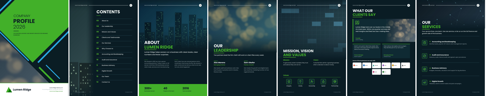
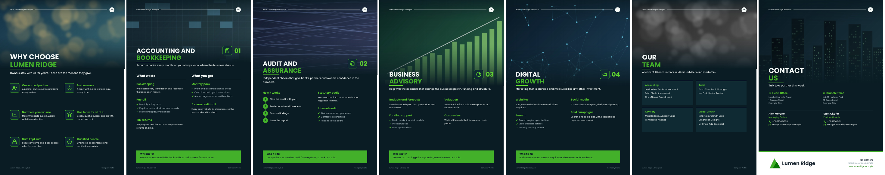

# profile-studio

A Claude Code skill that makes a print-ready **company profile** (A4 PDF brochure) for a business.

You give Claude the old profile, the website and a brief. Claude plans the content, gives you a Word
review copy for the client, then builds an image-led design with icons, live text and the true-colour logo.
Every page comes from one `profile.json`, so a change to the words is a rebuild, not a redesign.




*The example profile is for a fictional firm. All its art is drawn by `tools/make_example_assets.py`.*

## What you get

| Output | Detail |
|---|---|
| PDF profile | A4, vector pages, embedded Poppins font, live text you can search and copy. |
| Word review copy | The words only, page by page, for client sign-off before design. |
| Checks | Fonts embedded, every word present in the PDF, copy that overflows a box, a contact sheet of all pages. |

Page types: cover (2 styles), contents, about, leadership, mission and values, clients and testimonials,
services overview, why choose us, service pages, team, contact.

## Install

1. Install the Python packages:

   ```bash
   python3 -m pip install --user reportlab pillow svglib python-docx
   ```

   On Python 3.9, use `"reportlab<5.1"` in place of `reportlab`: reportlab 5.1 needs Python 3.10 or later.
   `python3 -m pip install --user -r requirements.txt` selects the correct version for you.

2. Install poppler for the checks (optional, recommended):

   ```bash
   brew install poppler
   ```

   On Debian or Ubuntu use `sudo apt install poppler-utils`.

3. Add the plugin in Claude Code:

   ```
   /plugin marketplace add AdityaPratamaS18/profile-studio
   /plugin install profile-studio@profile-studio
   ```

## Use

Ask Claude for a company profile, for example: "Make a company profile for our firm. The old one is
in old-profile.pdf and the website is example.com." The skill takes you through these stages:

1. Collect the facts from your sources.
2. Plan the content in `profile.json`.
3. Send the Word review copy to the client.
4. Add the logo and photos.
5. Build, check and iterate.

You can also run the tool yourself:

```bash
python3 skills/profile-studio/scripts/profile.py new my-profile --name "My Firm"
```

```bash
python3 skills/profile-studio/scripts/profile.py check my-profile
```

The field reference is in [profile-format.md](skills/profile-studio/references/profile-format.md).

## Photos and licences

The skill does not download stock photos. Use photos that you have the right to print, and keep a
record of each source. Do not commit licensed stock photos or a client's material to a public repository.

| Bundled file | Licence |
|---|---|
| Poppins font | SIL Open Font License 1.1 (`assets/fonts/OFL.txt`) |
| Lucide icons | ISC (`assets/icons/LICENSE-lucide.txt`) |
| Example art | MIT, drawn by `tools/make_example_assets.py` |
| Code | MIT (`LICENSE`) |

## Test

```bash
bash tests/smoke_test.sh
```
